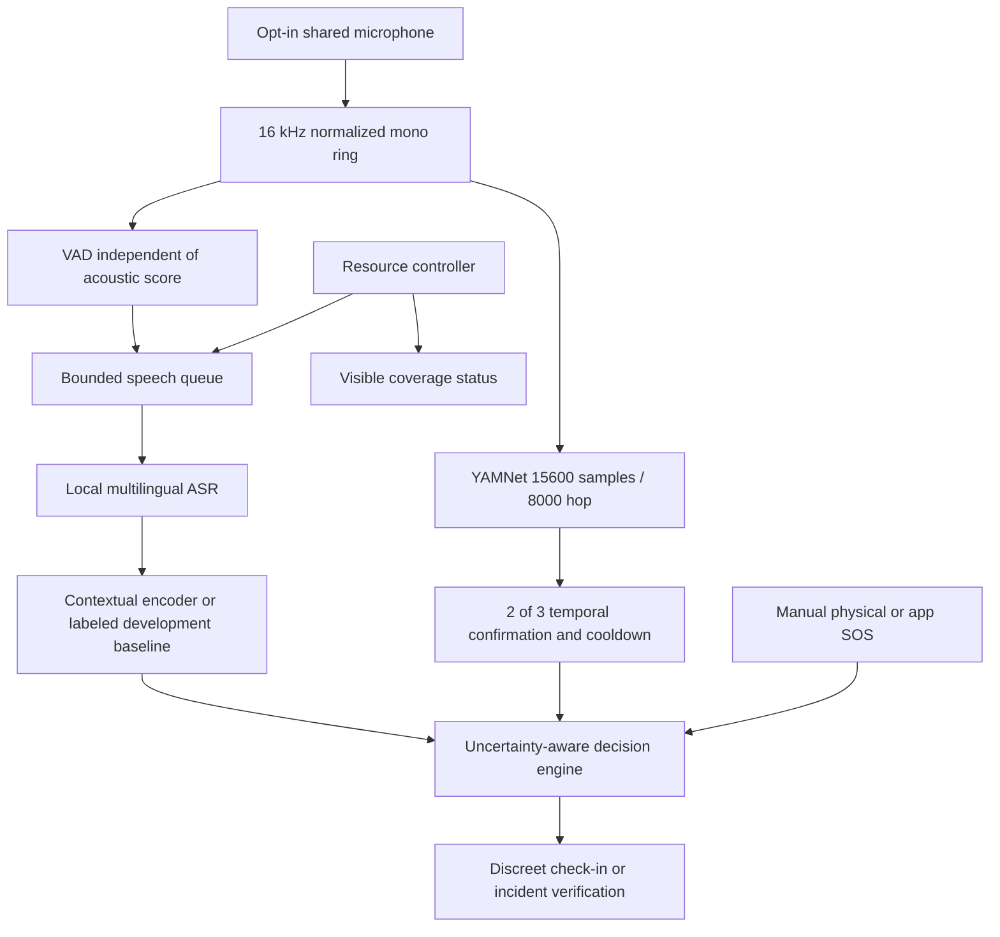

# Architecture

Task 4 current coordination and monitoring-only semantics are documented in
[Member 2 final handoff](member2-final-handoff.md). The older flow/helper descriptions
below retain historical context; new ML integration uses `MlController` /
`MLCoordinator`, not direct high-level emergency calls. See the
[final test report](member2-final-test-report.md) for current artifact/runtime limits.

Python implements the complete development flow, with energy VAD as the default
unvalidated fallback and optional Silero adapter. Android demo implements acoustic monitoring, manual incident callbacks and
bounded VAD-triggered Vosk speech inference with bundled English/Hindi model
assets and an unvalidated baseline. Events reach generic local notifications;
the main application owns any external incident workflow. Optional Android Vosk ASR and a conservative heuristic text classifier are implemented;
validated multilingual Whisper/encoder backends remain integration boundaries. No network permission,
transcript upload, gender inference or automatic contact dispatch exists.

Scores are evidence, not probabilities of danger. Unknown or heuristic text risk
can produce Level 1 only. Confirmed acoustic or validated strong text indicators
can produce Level 2. An active incident suppresses equal/lower alerts until local
resolution; manual SOS always bypasses suppression. External escalation belongs
to the host app after explicit user preferences and cancellation safeguards.
