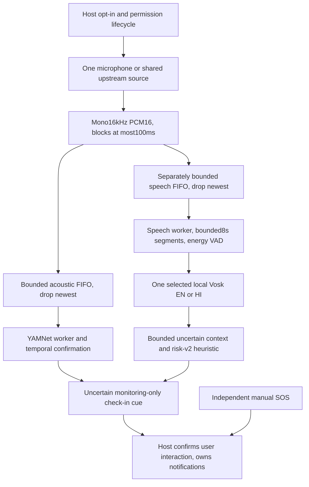

# SAFORA Audio ML — Member 2 final handoff

## Delivery status

Task 4 branch `feat/task4-ml-integration` is stacked on Task 3
`d53d3697d0f134284dee6c182a1b6411148fb2dc`; PR base is
`feat/task3-conversation-risk`. All PRs remain unmerged.

This is an offline monitoring subsystem and developer demonstration, **not a
production-ready safety detector**. No model proves danger, gender, criminal intent
or consent. ML produces uncertain local check-in requests requiring user
confirmation. Manual SOS remains an independent user action owned by the app;
this subsystem sends no contacts/SMS/location/police/cloud dispatch.

| Component/version | Delivered | Remaining evidence/model work |
|---|---|---|
| YAMNet classification TFLite1 | Real pinned float32 model, class11 screaming; bounded Task 1 monitor and Kotlin backend/controller | Provisional0.30 /2-of-3 threshold,10s cooldown; poor reused external-set results, no verified safety coverage |
| Vosk Small en-us0.15 | Real pinned model, hardened Python/Kotlin PCM/native lifecycle; independent speech worker | No representative WER/CER or physical-device speech benchmark |
| Vosk Small hi0.22 | Real pinned model, explicit Hindi selection and same worker contract | Hindi/Hinglish and code-switch accuracy unvalidated; no automatic LID |
| risk-v2 rules | Task 3 Python UNVALIDATED_HEURISTIC plus bounded Kotlin MonitoringRules port |12 shared software contract fixtures, not linguistic/population validation |
| Learned risk encoder | **Not delivered; no genuine trained/exported weights** | Licensed human-labeled dataset, compatible local base, training/runtime dependencies, validation thresholds/test evaluation and numerical export parity absent |
| Experimental scream LR/MIL postprocessors | **Excluded** from inference/decisions | Failed generalization; no production promotion or threshold tuning on reused30 clips |

Task 1/2/3 reports retain their exact historical scope. Task 4 supersedes the old
serialized Python/Android demo flow for new integration; it does not erase prior
accuracy limitations. No representative safety accuracy or battery/low-RAM target
is established.

## Architecture and owner boundaries



**Audio ML deliverables:** Python `coordinator.MLCoordinator`, Task 1 ingestion/
resampling/evaluation, Task 2 ASR/assets/evaluation, Task 3 risk/data/training/export
guards, Kotlin `MlController`, `MonitoringRules`, existing `Yamnet`/`VoskSpeech`,
asset validation, metrics, regression/smoke tooling and these contracts.

**Kotlin teammate responsibilities:** permission/opt-in UX, foreground service and
notification behavior, Android lifecycle/OEM interruptions, main-app feature flags,
user-confirmed incident workflow, independent manual SOS, contacts/location/firmware
and any external dispatch. UI/screens/service app ownership was preserved. Only
Android AI core internals and isolated instrumentation tests changed. Existing demo
`AudioPipeline` now delegates to the core; the service/UI call signatures stay
compatible. The old `DevelopmentClassifier` remains for legacy callers/tests;
Task 4 uses `MonitoringRules`. Do not confuse the two rule implementations.

## Input, assets and provisioning

New coordinator/core input: **mono16,000Hz signed PCM16**, or Python normalized
finite floats `[-1,1]`; at most1600samples/100ms per submission. Kotlin ShortArray
contains signed PCM values; wire bytes are little-endian PCM16. Task 2 codecs use
round-to-nearest/even, float*32768, endpoints -32768/+32767. No automatic gain.
Task 1 standalone monitor can resample other rates, but the new shared coordinator
requires one upstream16kHz stream: resample/mix once with a stateful converter, not
separately per ASR/acoustic chunk. Android AudioPipeline requests mono16kHz PCM16
from one AudioRecord. No second microphone is opened by MlController.

YAMNet pinned tensor contract float32[15600] -> float32[1,521], screaming index11,
8000sample hop. Python derives/validates model metadata; Kotlin validates shape and
dtype against this exact supported pinned model. Scores are independent class
scores, not danger probabilities. Unsupported model shapes/dtypes fail, not guess.

Grounded assets (not committed as huge binaries):

| Asset | Archive/file bytes | SHA256 |
|---|---:|---|
| yamnet.tflite |4,126,810|`10c95ea3eb9a7bb4cb8bddf6feb023250381008177ac162ce169694d05c317de`|
| vosk-en.zip |41,205,931|`30f26242c4eb449f948e42cb302dd7a686cb29a3423a8367f99ff41780942498`|
| vosk-hi.zip |44,458,845|`7c50a10866889f0ac21d912c20537a055a597ed09fc1d3e5bcd798f9f0017e48`|

Use `models/android-assets.json` for exact model roots, upstream URLs and existing
Apache-2.0 provenance/license notices. Preserve `LICENSES.md`,
`models/android-model-notices.md`, main-APK `MODEL-NOTICES.txt` and
`MODEL-LICENSE-APACHE-2.0.txt`. Do not redistribute private recordings/datasets.

```bash
# Explicit setup only; inference never downloads or needs an API key.
pip install -e '.[vosk,yamnet]'  # Add [microphone] for the host mic demo.
PYTHONPATH=python python scripts/prepare_vosk.py --language en \
  --archive /local/vosk-en.zip --output /local/models/en
PYTHONPATH=python python scripts/prepare_vosk.py --language hi \
  --archive /local/vosk-hi.zip --output /local/models/hi
# --download is an explicit optional provisioning action, not runtime behavior.
PYTHONPATH=python python scripts/prepare_android_assets.py --cache /local/model-downloads
```

Python preparation authenticates supplied archives and extracted-file receipts.
Direct model-directory loading needs supplied file checksums for cryptographic
provenance. Android validates bundled archive SHA before extraction, bounded ZIP
paths/total size and required nonempty Small-model files; selected models live in
app-private storage. Cached `.ready` proves which verified archive was prepared,
not a fresh per-file hash audit. Corrupt directories may still fail native loading;
clear the selected cached directory and reprovision after investigating. No
multi-hundred-MB learned-risk assets or experimental postprocessor weights exist.

## Kotlin integration calls

For a main app already owning microphone capture, use **MlController**, not
AudioPipeline (which itself owns AudioRecord):

```kotlin
val core = MlController(
    acousticFactory = {
        val yam = Yamnet(context)
        object : AcousticBackend {
            override fun scream(samples: FloatArray) = yam.scream(samples)
            override fun close() = yam.close()
        }
    },
    speechFactory = { lang ->
        // Called only on speech worker; no capture/UI blocking.
        val dir = runBlocking { ModelAssets.prepareVosk(context, lang) }
        VoskSpeech(dir.absolutePath)
    },
    onCue = { cue ->
        // Marshal to app owner; re-check running/session/generation there after dispatch.
        // Request user-confirmed local check-in only. Never auto-dispatch.
    },
    onStatus = { fixedCode -> /* surface truthful coverage, no transcripts */ },
    cpuClock = { android.os.Debug.threadCpuTimeNanos() }
)
core.configureSpeech(false, "en") // Optional conversation OFF by default.
core.start(permission = micPermissionGranted, optedIn = explicitOptIn)
// One existing capture callback; startSample is source frames, monotonic, end exclusive.
core.submit(pcm16MonoBlock, size = count, startSample = capturedFrames)
// Background control owner, explicit model choice; null = unknown/no recognition.
core.configureSpeech(true, "hi")
core.configureSpeech(false, null) // Releases speech model after in-flight work returns.
// On permission loss/opt-out/capture route change, stop input before teardown.
val joined = core.stop(5000)
// If false, retain this owner and retry joining; do not close its native model externally.
// Resume via start only after all old workers have exited; session ID increases.
```

Caller handles AudioRecord errors/permission revoke by closing its capture source
and calling `permissionLost()`/`stop()` from a background owner. UI-thread stop
must not wait on native inference. Existing demo `AudioPipeline.start/stop` handles
its own single AudioRecord permission check/cleanup and exposes
`setConversationEnabled`, `setSpeechLanguage`; the unchanged app still controls
mode and opt-in. A same-language reset can be expressed by disable/re-enable;
new sessions require complete stop/join/start. Unknown language never guesses LID
or concatenates separate EN/HI recognitions. Hinglish is not a selectable decoder.

MlCue includes session, generation, source, sample end, language/ASR uncertainty
where available, explicit uncertain/monitoringOnly/requiresUserConfirmation flags
and provenance. No raw transcript is exposed in cues or persistent metrics.
Native inference is noninterruptible; callbacks already executing cannot be
recalled. Recheck session/generation after marshaling to another thread.
`DecisionEngine.monitoringCue()` emits level1 local concern only. Core never calls
legacy `acoustic()`/validated `conversation()` high-level paths. Those remain for
compatibility; the host must not wire ML directly to them. `manual()` remains
available even with no models/permission/opt-in and bypasses lower-priority
cooldowns. Neither level means authorization for external dispatch.

## Python flow and runnable smoke

`MLCoordinator` accepts the same shared stream; it reuses Task 1 monitor, Task 2
StreamingASR and Task 3 ContextBaseline. No learned backend is silently selected.
Python adds a bounded segmentation queue/worker upstream of the ASR queue, so even
slow VAD/native work cannot run in capture. `configure_speech`, `permission_lost`,
`opt_out`, `stop` and fresh-session `start` clear stale context/generations; manual
SOS is separate. Lifecycle controls have one host owner. Start/model initialization
belongs off the UI thread. stop(false) retains retiring native owners and rejects
resume until they exit. `wait_idle`/Kotlin `awaitIdle` are test/background barriers,
never capture operations.

```bash
PYTHONPATH=python python scripts/monitor_ml.py --yamnet /local/yamnet.tflite \
  --english-model /local/models/en --hindi-model /local/models/hi --speech --language en
# Ctrl-C closes one microphone, then joins model workers. Requires local mic/PortAudio.
PYTHONPATH=python python scripts/ml_coordinator_smoke.py --yamnet /local/yamnet.tflite \
  --english-model /local/models/en --hindi-model /local/models/hi \
  --english-pcm16 android/app/src/androidTest/assets/synthetic-refusal.pcm16 \
  --hindi-pcm16 /local/authored-hindi.pcm16 --output /local/native-coordinator.json
```

Host microphone script is supplied, not microphone-tested in this environment.
The native file smoke was actually run, paced by idle barriers; it is not a
real-time capture or performance benchmark. Hindi fixture provenance/recreation
is in the Task 2 report. Native transcripts are not persisted.

## Defaults, losses, privacy and resource contracts

`configs/ml-monitor-v1.json` documents implemented defaults; it is a reference
manifest, not an automatically loaded Android config. Python acoustic FIFO4blocks,
Kotlin acoustic FIFO2blocks, speech input FIFO2blocks; Python additionally has
ASR FIFO2segments. All drop **newest**, never wait for inference, and preserve
absolute source offsets including losses. Kotlin speech drops/control generations
no longer reset acoustic continuity. Actual acoustic gaps reset its ring/temporal
confirmation; speech gaps/language changes/opt-out discard partial speech/context.
No missing audio is replayed. Explicit source discontinuities reset both. Source
sample clock is monotonic; Kotlin AudioRing timestamps have millisecond resolution.

Speech uses fixed bounded8s segments and unvalidated RMS≥0.008 energy VAD. Tail
segments are discarded on stop/configuration changes rather than delayed/replayed.
No reliable endpointing/quiet-speech coverage is claimed. Context≤4turns/30source
seconds, unknown speakers, uncertainty preserved. Sustained silence expires stale
context before the next result; input gaps and controls clear it immediately.
Thresholds: YAMNet0.30,2hits in3windows,10s acoustic cooldown; check-in cooldown10s.
Python cooldown uses monotonic wall time; Kotlin core uses monotonic nanoClock.
Existing demo DecisionEngine additionally suppresses repeated lower-level concerns
until the host resolves the active local incident.

Models are single-worker-owned, one selected speech model resident, with local-only
loading and finally cleanup; resume never shares a retiring native handle. Cues/
metrics/status contain fixed codes/counters and no audio/text. Transient buffers
are cleared; immutable/native strings are not guaranteed secure erasure. Callbacks
must be fast; a slow callback can cause bounded queue drops but cannot make capture
wait for inference. Native fault recovery retries on later input; repeated missing
assets can repeatedly fail, so disable affected coverage and fix provisioning.
Do not interpret a failed acoustic backend as enabled protection. Kotlin MlState
exposes readiness/drop/error state; Python exposes acoustic/asr counters and coverage.
The main app should surface that coverage state rather than generic protection.

Memory bounds refer only to buffered audio, not whole-process/native RAM. Kotlin
has two queues of ≤2*1600*2bytes each plus in-flight copies and one512KB speech buffer;
Python adds up to2*8s ASR float32 chunks (~1MiB) plus current segment/native memory.
Native model memory dominates; no physical2–3GB phone/battery target is verified.
Disable optional speech on resource pressure and keep acoustic/manual paths
independent. PipelineMetrics measures CPU/wall inference, queue/drop/skip counters
and caller-sampled PSS/RSS; speech drops/readiness are available separately in
MlState. Existing demo metric JSON does not yet surface all new core speech fields.

## Build variants, testing and follow-up

```bash
cd android
./gradlew :safora-ai-core:testDebugUnitTest :app:assembleDebug :app:assembleDebugAndroidTest :app:lintDebug
# Authorized connected emulator/device:
./gradlew :app:connectedDebugAndroidTest
```

Debug APK includes pinned YAMNet/Vosk and notices. Instrumentation APK contains
only authored speech fixtures/tests; main APK excludes test recordings. Release
uses the same asset validation task, but no release APK/signing, shrinker/operator
or Play readiness is established by these debug checks. Keep main-app signing and
permission/foreground-service policies with its owner. Native64-bit ELF16KB
alignment remains a distribution blocker; ZIP alignment is a different check.

Actual counts/build/hash/resource evidence and initial failures/fixes are in
[final test report](member2-final-test-report.md). Emulator startup for Task 4 was
blocked by insufficient disk; no Task 4 APK was installed/run. New MlCoreSmokeTest
and prior DeviceSmokeTest compile and are runnable, but not executed in Task 4.
Do not apply historical emulator evidence to this changed artifact.

Prioritized next work:

1. Kotlin owner: run both instrumentation suites on authorized runtimes/physical
   low-RAM phones; test real mic, permission revoke/deny, background/lock/call,
   start-stop-resume, resource switches, queue pressure, generation checks, PSS/
   latency/battery. Validate actual end-to-end user-confirmed check-in notification.
2. Fix16KB native library distribution readiness and verify release variants/OEM
   lifecycle. Surface richer core readiness/speech-drop/language metadata in the
   teammate-owned app without changing manual SOS responsibility.
3. Audio ML/data team: obtain compatible licensed/consented data and independent
   bilingual human labels/source splits; preserve an untouched benchmark. Reused
   external scream data is not independent. Evaluate quiet/noise/brief screams,
   ASR English/Hindi/Hinglish, hard negatives and rule failure cases honestly.
4. Only after legitimate supervised risk training, frozen validation thresholds,
   held-out evaluation and numerical/tokenizer parity should a learned risk adapter
   be considered. Current torch/transformers/onnx/onnxruntime/base/data blockers
   remain. No request to merge or promote a production safety model is made.
